# OrbiBot V1

A mecanum-wheeled indoor robot: a welded stainless-steel frame, a Raspberry
Pi 5 running ROS 2 Jazzy, and an STM32 motor board running firmware I wrote.
It maps a room with its LiDAR, localises on the map, runs Nav2, is driven from
a web dashboard, and has an AI agent with 58 robot tools.

At Orbitax, I build OrbiBot in my free time, on the way to a telepresence
robot for the office. V1 is the first step: the mobile base, which I built
and programmed.

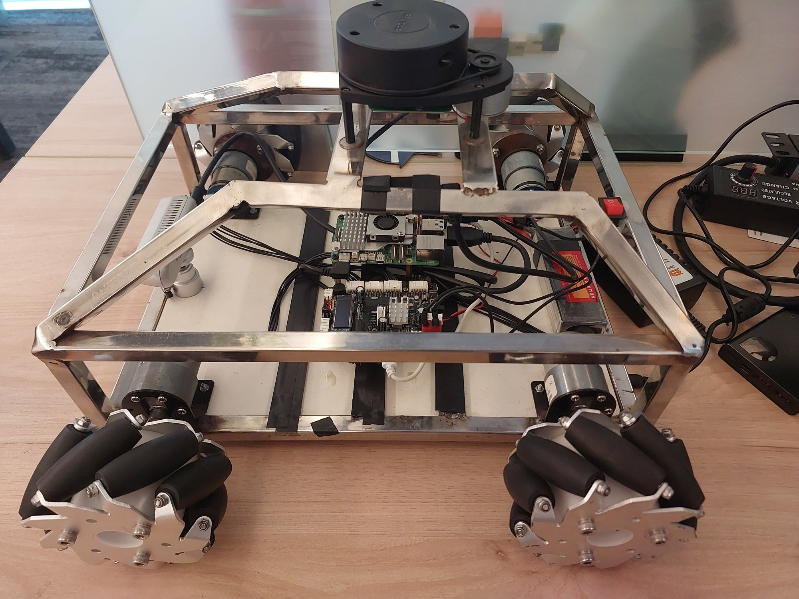

| | | |
|---|---|---|
| <a href="docs/media/orbibot-v1-2025-07-20-gamepad-slam-map.mp4">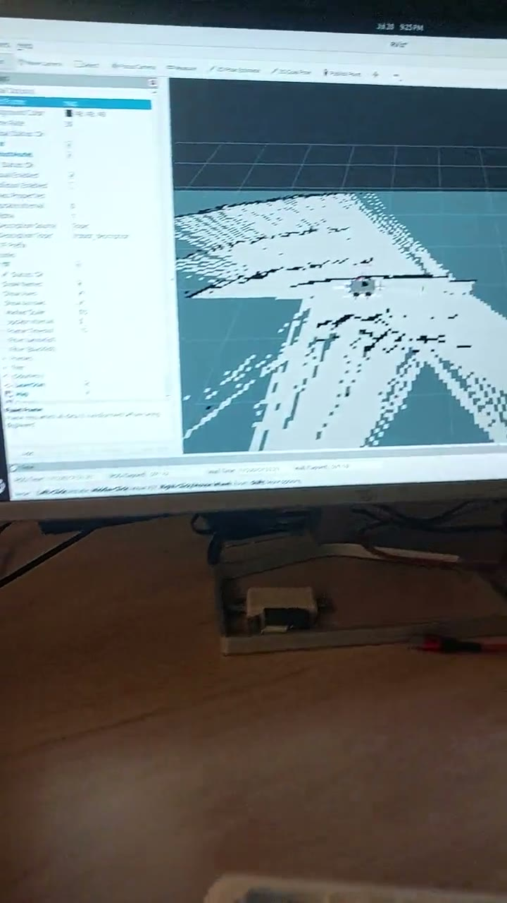</a><br>**July 2025:** the Raspberry Pi 5 build, the gamepad it was driven with, and its SLAM map in RViz ([video](docs/media/orbibot-v1-2025-07-20-gamepad-slam-map.mp4), 15 s) | <a href="docs/media/orbibot-v1-2026-01-08-driving-on-home-map.mp4">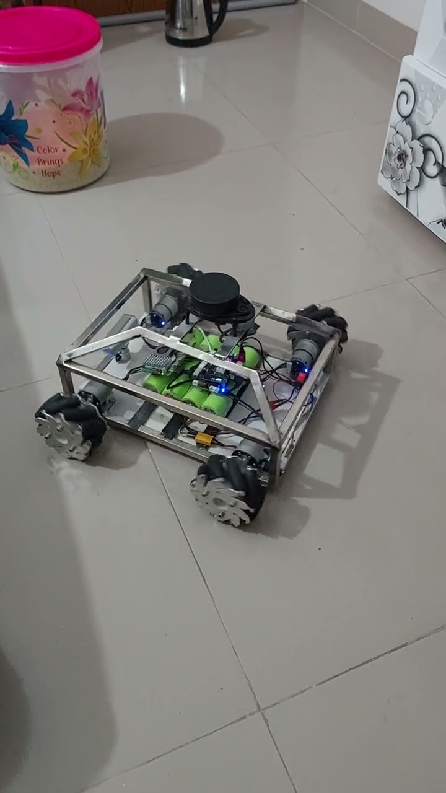</a><br>**January 2026:** the home map in RViz, then the robot driving on it, sideways and turning ([video](docs/media/orbibot-v1-2026-01-08-driving-on-home-map.mp4), 36 s) | <a href="docs/media/orbibot-v1-2026-02-09-dashboard-teleop.mp4">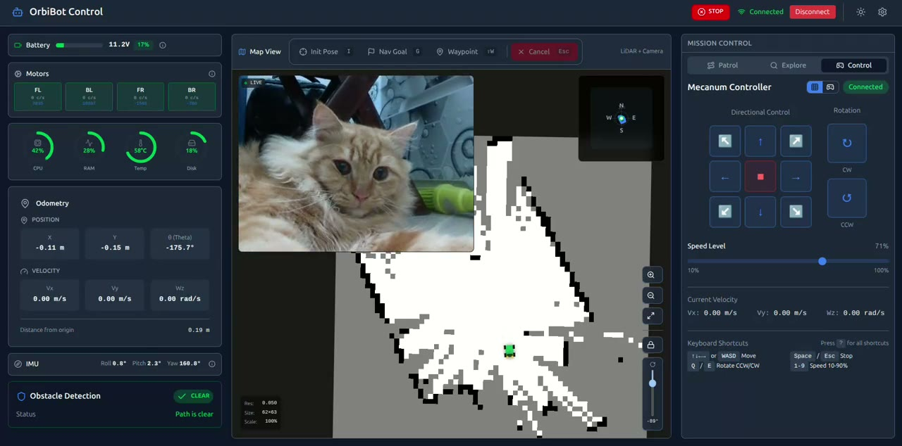</a><br>**February 2026:** driving from the web dashboard, with the live camera and the map ([video](docs/media/orbibot-v1-2026-02-09-dashboard-teleop.mp4), 30 s) |

**Status: built.** V1 is the first OrbiBot.
What was tested and how, and what is known to be wrong, is in
[docs/status.md](docs/status.md).

## What it does

- **Drives in any direction.** Four 100 mm mecanum wheels, each with its own
  PID speed loop at 100 Hz on the STM32, so it moves sideways and turns on the
  spot.
- **Keeps the deadlines on the microcontroller.** PID, encoder counting and a
  2 s command timeout run on the STM32 under FreeRTOS. If the Pi stops
  talking, the motors stop. The Pi never has to be real-time.
- **Maps and localises.** An EKF fuses wheel odometry with a Madgwick-filtered
  IMU; slam_toolbox builds the map from the RPLIDAR A1, and the robot
  localises on a saved map.
- **Navigation, set up but not measured.** Nav2 with the MPPI controller and
  its omnidirectional model, and AMCL on saved maps, was set up and run in a
  small room in March 2026; nothing about it was measured. Frontier
  exploration is written but not yet tested against a tuned Nav2.
- **Is driven from a browser.** A React dashboard over rosbridge shows the
  battery, motors, odometry, IMU, LiDAR, the live map and the camera (over
  WebRTC), drives the robot with on-screen controls or the keyboard, sets Nav2 goals and
  tunes the PID. It never touches the hardware directly: every command goes
  through the same ROS 2 topics.
- **Has an AI agent.** `orbibot_agent` works with Gemini, Claude, Kimi or a
  local Ollama model, and gives them 58 robot tools (motion, sensors,
  firmware, ROS 2, navigation, diagnostics) behind a safety layer that caps
  speed and duration. It serves an HTTP chat API (used by the dashboard), a
  terminal CLI and an MCP server.

## The build

| | | |
|---|---|---|
| 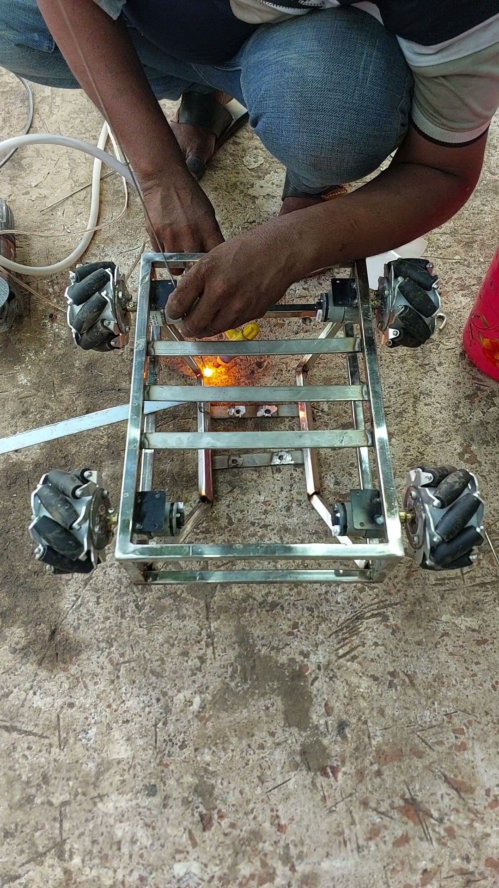<br>**2025-06-11:** the stainless-steel frame being welded | 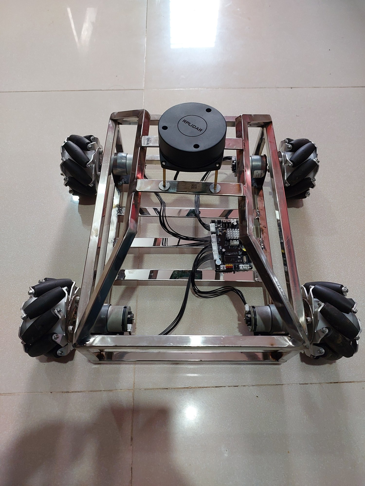<br>**2025-06-12:** the frame with its four geared motors, the RPLIDAR A1 and the motor board | 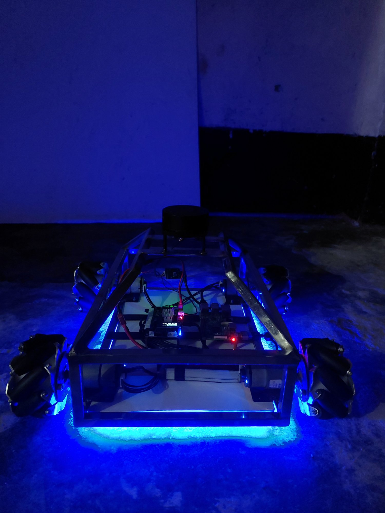<br>**2025-06-13:** first electronics, first light: a Raspberry Pi and the motor board on the deck |
| 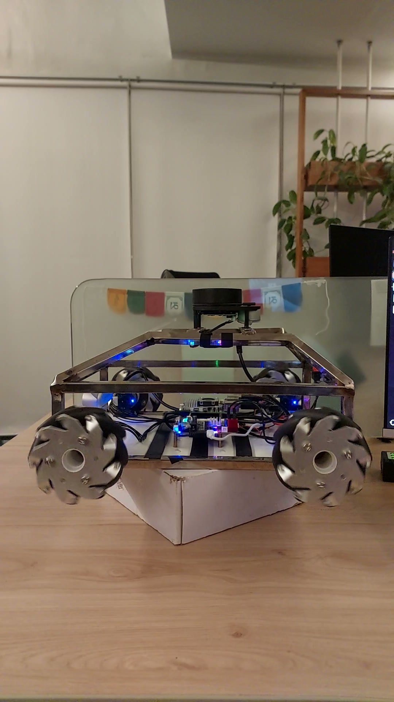<br>**2025-06-30:** wheels off the desk for a motor test | 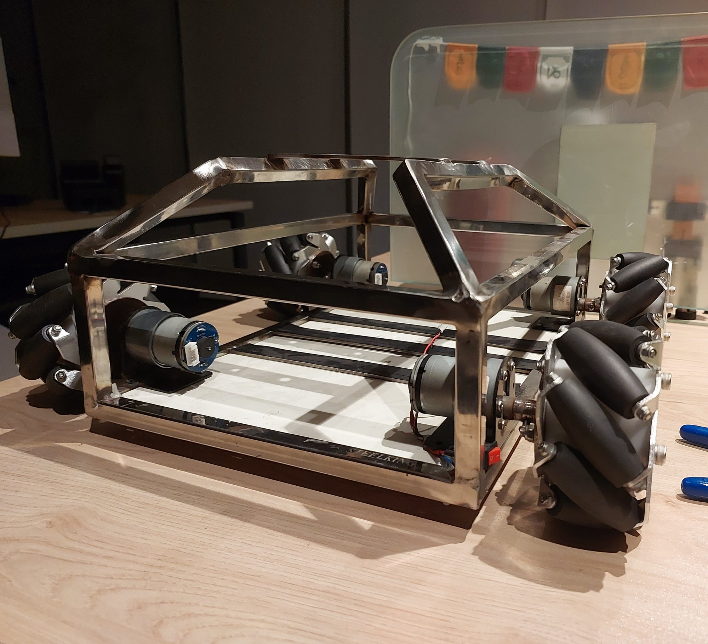<br>**2025-11-06:** stripped back to the frame for a rebuild: four JGB37-520 motors with Hall encoders | 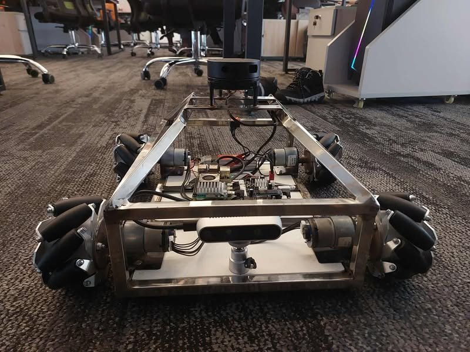<br>**2025-11-25:** rebuilt, with a RealSense D435 at the front |
| 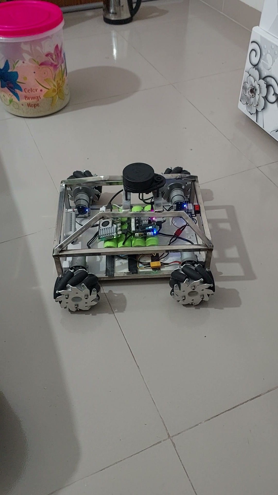<br>**2026-01-08:** driving at home, with the LiFePO4 cells on the deck | 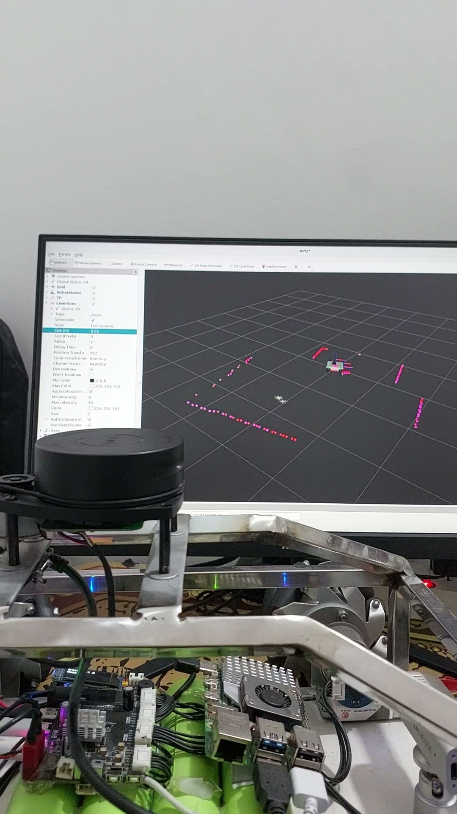<br>**2026-01-12:** checking the LiDAR scan in RViz | 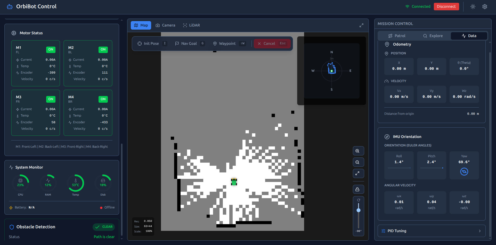<br>**The web dashboard:** motors, odometry, IMU and the SLAM map |

## How it works

```
   RPLIDAR A1 ──USB──┐
   RealSense  ──USB──┤   Raspberry Pi 5, ROS 2 Jazzy: SLAM, Nav2, EKF,
                     │   the dashboard's back end, the AI agent
                     └──────────────┬──────────────
                                    │ USB serial, 115200 baud
                     ┌──────────────┴──────────────┐
                     │ ROSMaster V3.0: STM32F103RC │  PID at 100 Hz, encoders,
                     │ my firmware, FreeRTOS       │  IMU, odometry, 2 s timeout
                     └──┬───────┬───────┬───────┬──┘
                       M1      M2      M3      M4
```

| Part | What it is | Where |
|---|---|---|
| Body | Welded stainless-steel frame, 350 × 250 mm, about 6 kg in the robot model; four 100 mm steel mecanum wheels; four JGB37-520 motors (30:1) with Hall encoders | [docs/hardware](docs/hardware/README.md) |
| Power | 4S LiFePO4 pack (12.8 V); the firmware warns at 11.0 V and cuts the motors off at 10.5 V | [docs/hardware](docs/hardware/README.md) |
| Computer | Raspberry Pi 5, Ubuntu 24.04, ROS 2 Jazzy | [Getting started](docs/getting-started.md) |
| Motor board and firmware | Yahboom ROSMaster V3.0 (STM32F103RCT6) with firmware I wrote in place of the vendor's closed one: mecanum kinematics, PID, odometry, the ICM-20948 IMU, a binary serial protocol, PID gains in flash, a watchdog | [orbibot_rosmaster_firmware](src/orbibot_rosmaster_firmware/README.md) |
| Bridge | The serial protocol to ROS 2: `/odom`, `/imu/data_raw`, `/joint_states`, motor services | [orbibot_hardware](src/orbibot_hardware/README.md) |
| Sensors | RPLIDAR A1 on `/scan`; RealSense D435, off by default; the dashboard uses its colour stream | [orbibot_sensors](src/orbibot_sensors/README.md) |
| Model | URDF/Xacro; `base_footprint` is the base frame | [orbibot_description](src/orbibot_description/README.md) |
| Localisation | Madgwick (no magnetometer) and a robot_localization EKF | [orbibot_localization](src/orbibot_localization/README.md) |
| Mapping | slam_toolbox, for mapping and localisation | [orbibot_slam](src/orbibot_slam/README.md) |
| Navigation | Nav2: MPPI with the `Omni` model, AMCL, velocity smoother, collision monitor; set up and run, not measured | [orbibot_navigation](src/orbibot_navigation/README.md) |
| Exploration | Frontier search that drives Nav2 | [orbibot_exploration](src/orbibot_exploration/README.md) |
| Dashboard | React 19, TypeScript, Vite; rosbridge on port 9090, the WebRTC camera on 8081 | [orbibot_webgui](src/orbibot_webgui/README.md) |
| AI agent | Gemini, Claude, Kimi or Ollama; 58 tools; HTTP chat on 8082, CLI, MCP | [orbibot_agent](src/orbibot_agent/README.md) |
| Launch | The robot base, mapping and exploration | [orbibot_bringup](src/orbibot_bringup/README.md) |

## Repository layout

The repository root is the colcon workspace.

| Path | What it holds |
|---|---|
| `src/` | The 12 ROS 2 packages and the STM32 firmware, one folder each; the list is in [docs/packages.md](docs/packages.md) |
| `docs/` | Getting started, status, architecture, hardware, operations, testing, 70 lessons, and `media/` for this page |
| `.claude/` | The rules, hooks and robot scripts for working on it with Claude Code |
| `CLAUDE.md` | The guide for AI coding agents |
| `CONTRIBUTING.md` | How the code and its documentation are kept in step |
| `LICENSE`, `NOTICE`, `LICENSES/` | Apache-2.0, and the third-party notices |

Each package keeps its own `README.md`, and where it has them, `CHANGELOG.md`
and `known-issues.md`.

## Run it

You need the robot, or the same parts. On a Raspberry Pi 5 with Ubuntu 24.04
and ROS 2 Jazzy:

```bash
git clone https://github.com/jewel-nath/orbibot-v1.git ~/orbibot_ws
cd ~/orbibot_ws
./src/orbibot_hardware/scripts/setup_permissions.sh   # /dev/motordriver and /dev/lidar
source /opt/ros/jazzy/setup.bash
rosdep install --from-paths src --ignore-src -y
colcon build --symlink-install && source install/setup.bash

ros2 launch orbibot_bringup robot.launch.py           # the robot base
ros2 launch orbibot_webgui webgui.launch.py           # the dashboard's back end
```

The firmware is flashed separately, with PlatformIO. The full steps, with the
safety checks, are in [docs/getting-started.md](docs/getting-started.md), and
the launch recipes for mapping, navigation, exploration and the agent are in
[docs/operations/running.md](docs/operations/running.md). V1 was set up in
2025 and 2026; newer package versions may need small changes.

## My part, and others' work

I built the robot, wired it, and wrote its firmware, its ROS 2 packages, the
web dashboard and the agent.

It stands on others' work:

- **Yahboom**: the ROSMaster V3.0 board. My firmware keeps a protocol
  compatible with Yahboom's, and the serial driver in `orbibot_hardware`
  started from Yahboom's `Rosmaster_Lib`.
- **FreeRTOS** (MIT), **ST's STM32F10x Standard Peripheral Library** and
  **ARM's CMSIS**, in the firmware, with their notices kept.
- **[stm32-ssd1306](https://github.com/afiskon/stm32-ssd1306)** by Aleksander
  Alekseev (MIT): the OLED font table.
- **[m-explore-ros2](https://github.com/robo-friends/m-explore-ros2)** (BSD):
  the frontier search algorithm, re-implemented in Python.
- **ROS 2** and its ecosystem: Nav2, slam_toolbox, robot_localization,
  imu_filter_madgwick, rplidar_ros, realsense-ros and rosbridge; and
  **shadcn/ui**, **D3** and **roslib** in the dashboard.
- **[LGDXRobot2](https://lgdxrobot.uk/)** and **AuBot**: robots whose designs
  I compared mine with and borrowed ideas from, such as LGDXRobot2's MPPI
  weights and IMU calibration ([notes](docs/README.md#other-robots)).

The three wheel and LiDAR meshes in `orbibot_description` are third-party
CAD whose source wasn't recorded.

## Licence

Apache-2.0: see [LICENSE](LICENSE). The third-party parts keep their own
licences; [NOTICE](NOTICE) lists them. The vendored libraries keep their
notices in their files, and [LICENSES/](LICENSES/) holds the font table's.
