# Diagrams

Every diagram and plot from the [technical report](../report/README.md), each as
its own file:

- **PDF:** vector, sharp at any size. Use it for print, slides and LaTeX.
- **PNG:** about 216 dpi on white. Use it for READMEs, posts and web pages.

They share one colour code: blue is the STM32 and its firmware, green the
Raspberry Pi and ROS 2, orange the dashboard and the AI agent, grey hardware,
and red a warning or a gap.

| Diagram | What it shows | Files |
|---|---|---|
| 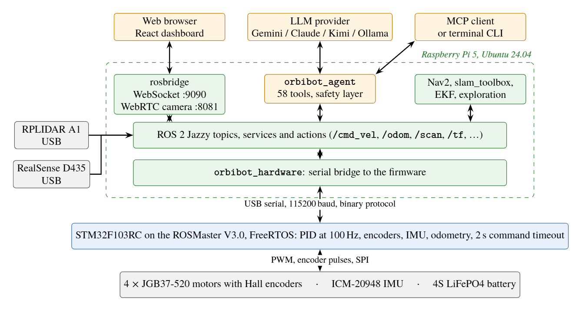 | The two-computer architecture, from users and sensors down to the motors | [PDF](orbibot-v1-system-architecture.pdf) · [PNG](orbibot-v1-system-architecture.png) |
| 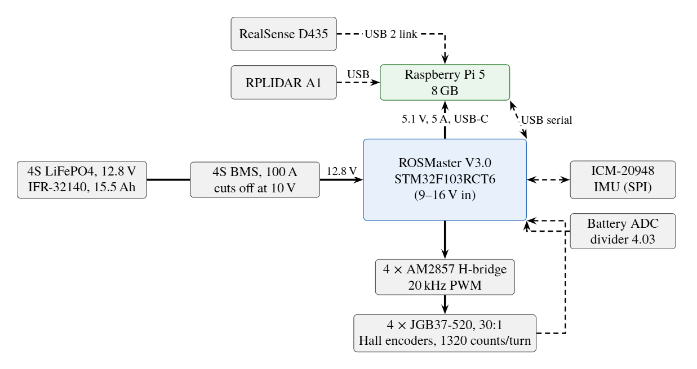 | Power and data paths between the battery, the boards and the sensors | [PDF](orbibot-v1-hardware-power.pdf) · [PNG](orbibot-v1-hardware-power.png) |
| 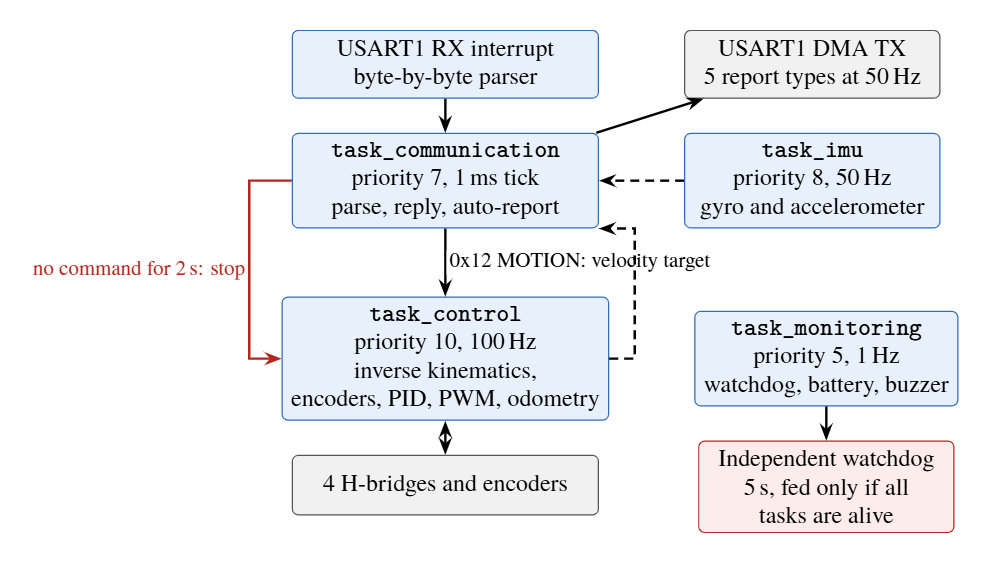 | The firmware's four FreeRTOS tasks and the path of a motion command | [PDF](orbibot-v1-firmware-tasks.pdf) · [PNG](orbibot-v1-firmware-tasks.png) |
| 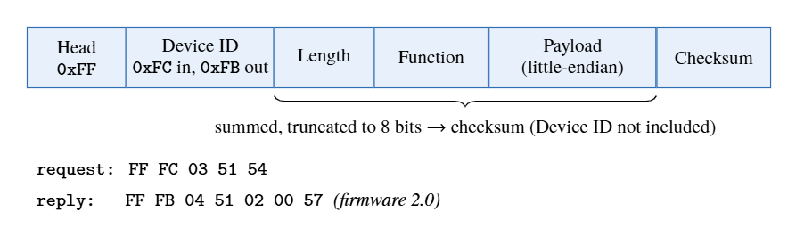 | The serial frame, with a recorded request and reply | [PDF](orbibot-v1-packet-format.pdf) · [PNG](orbibot-v1-packet-format.png) |
| 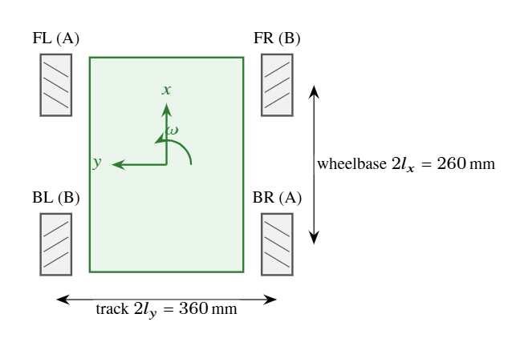 | Top view of the base, to scale, with the wheel layout | [PDF](orbibot-v1-mecanum.pdf) · [PNG](orbibot-v1-mecanum.png) |
| 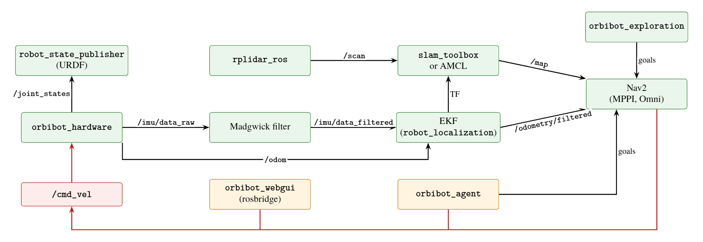 | The main ROS 2 packages and the topics between them | [PDF](orbibot-v1-ros-graph.pdf) · [PNG](orbibot-v1-ros-graph.png) |
| 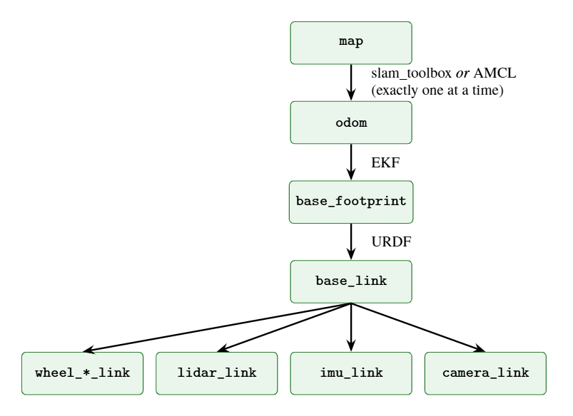 | The transform tree and who publishes each link | [PDF](orbibot-v1-tf-tree.pdf) · [PNG](orbibot-v1-tf-tree.png) |
| 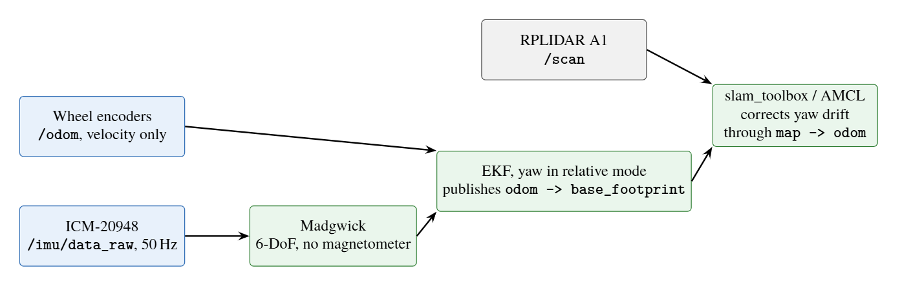 | State estimation: encoders and IMU to the EKF and the map | [PDF](orbibot-v1-estimation.pdf) · [PNG](orbibot-v1-estimation.png) |
| 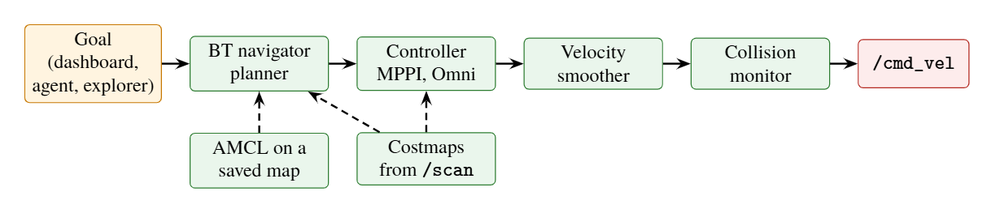 | Nav2's command chain on V1 | [PDF](orbibot-v1-navigation.pdf) · [PNG](orbibot-v1-navigation.png) |
| 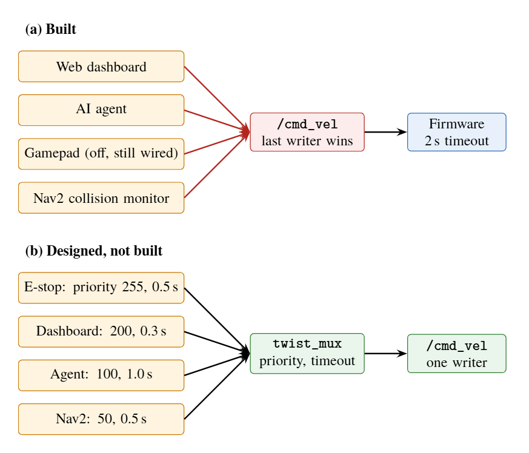 | `/cmd_vel` as built, and the designed `twist_mux` fix | [PDF](orbibot-v1-command-arbitration.pdf) · [PNG](orbibot-v1-command-arbitration.png) |
| 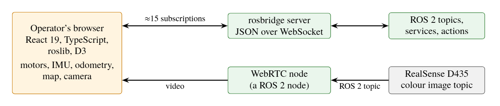 | The web dashboard's data paths | [PDF](orbibot-v1-dashboard.pdf) · [PNG](orbibot-v1-dashboard.png) |
| 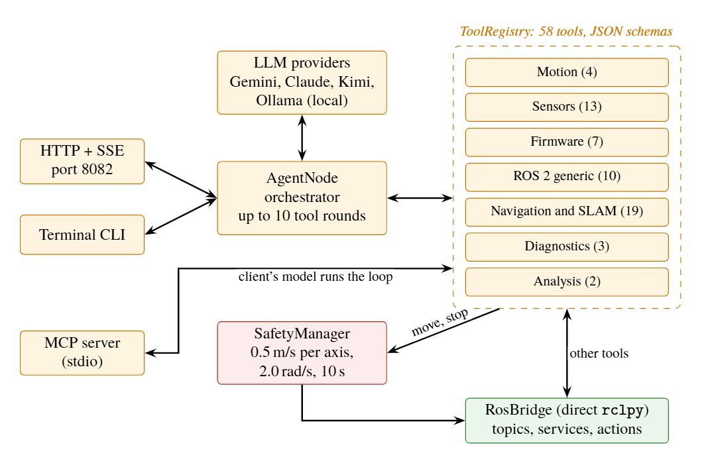 | The AI agent: interfaces, 58 tools, safety manager | [PDF](orbibot-v1-agent.pdf) · [PNG](orbibot-v1-agent.png) |
| 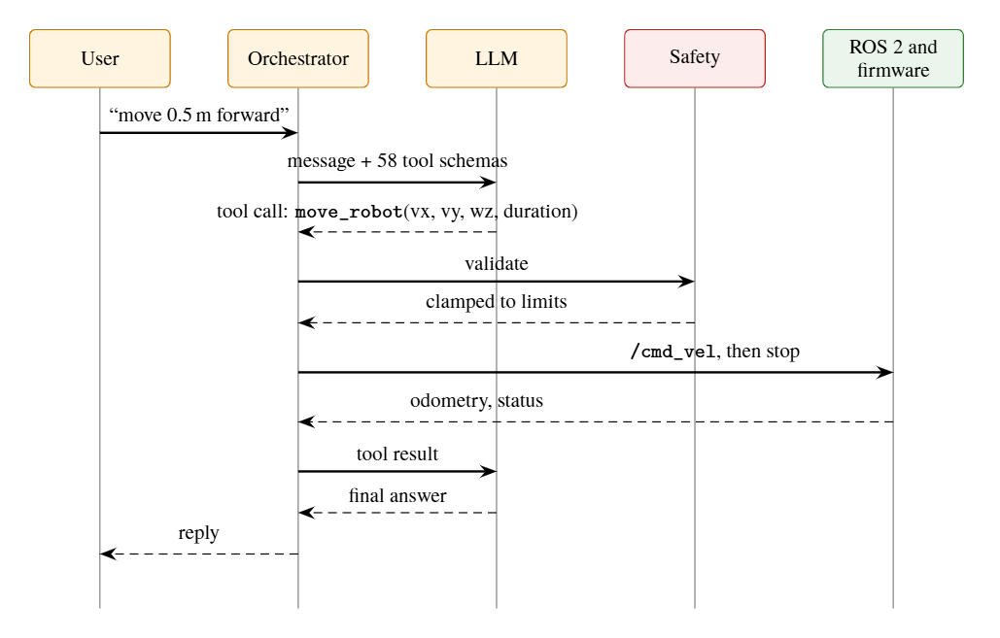 | One request through the agent, step by step | [PDF](orbibot-v1-tool-call-sequence.pdf) · [PNG](orbibot-v1-tool-call-sequence.png) |
| 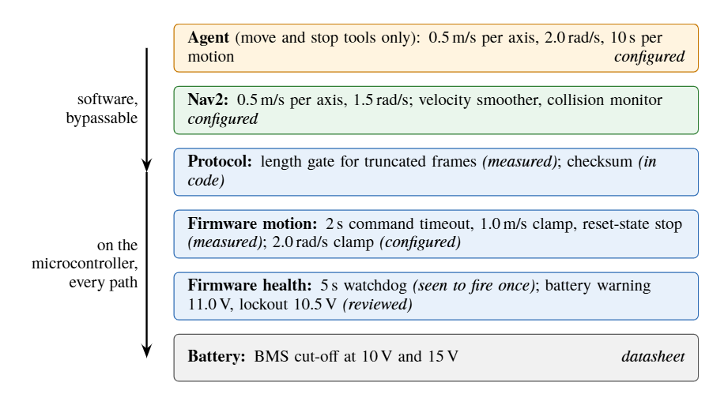 | Safety, layer by layer, and how far each is checked | [PDF](orbibot-v1-safety-layers.pdf) · [PNG](orbibot-v1-safety-layers.png) |
| 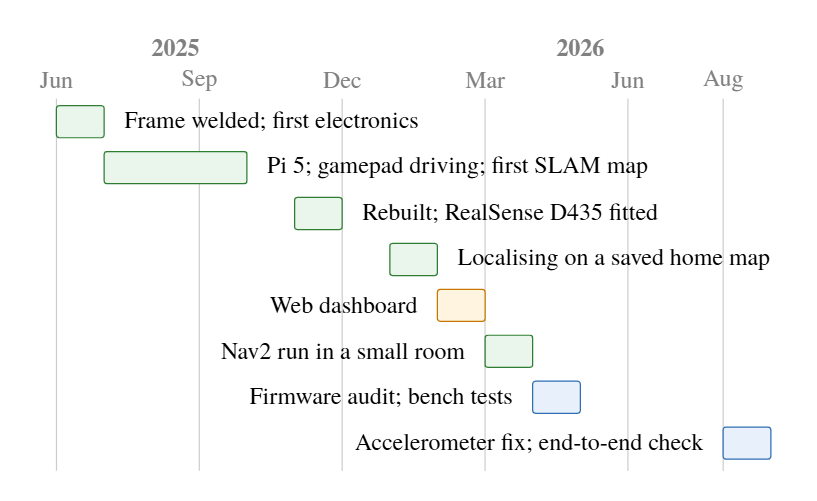 | The build, June 2025 to August 2026 | [PDF](orbibot-v1-timeline.pdf) · [PNG](orbibot-v1-timeline.png) |
| 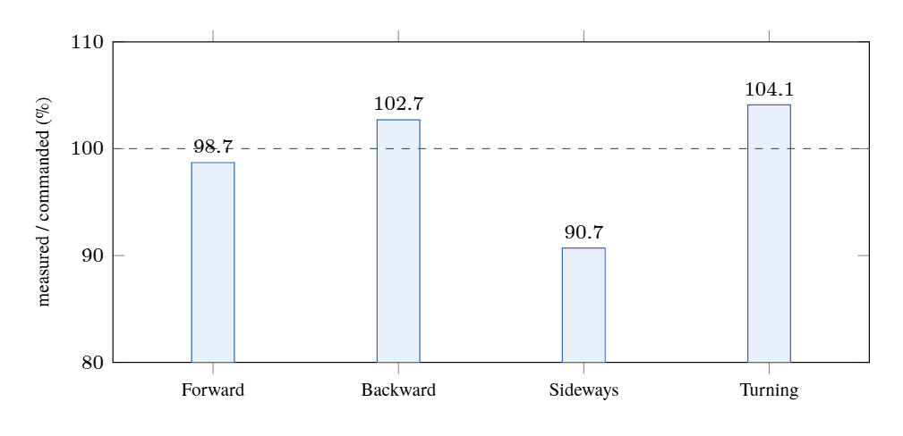 | Measured chassis velocity as a share of the command (bench) | [PDF](orbibot-v1-velocity-tracking.pdf) · [PNG](orbibot-v1-velocity-tracking.png) |
| 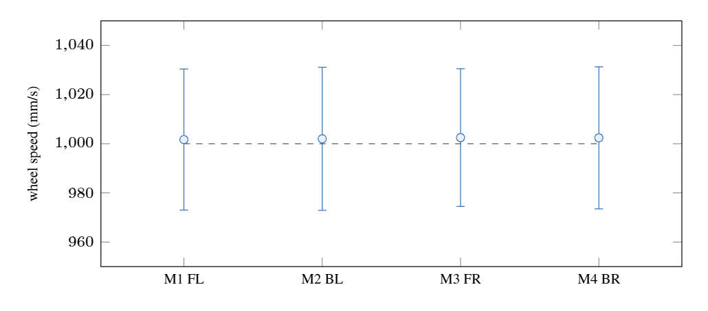 | Wheel speed per motor at the 1.0 m/s limit (bench) | [PDF](orbibot-v1-per-motor-speed.pdf) · [PNG](orbibot-v1-per-motor-speed.png) |
| 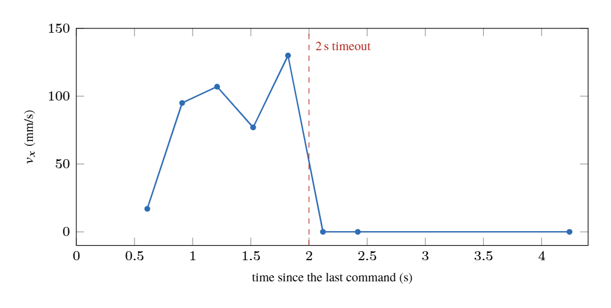 | The 2 s command timeout, measured (bench) | [PDF](orbibot-v1-timeout.pdf) · [PNG](orbibot-v1-timeout.png) |

The three plots show bench tests made with the wheels off the ground; see the
report for what was and wasn't measured before reusing them.

## Changing a diagram

The sources are the TikZ files in [docs/report/figures/](../report/figures/),
with the shared styles in `docs/report/figure-style.tex`. After an edit:

```bash
cd docs/report
python make-diagrams.py        # every figure as its own PDF, here
tectonic -X compile orbibot-v1-report.tex
```

The PNGs are rendered from these PDFs with pdf.js at scale 3, on a white
background.
