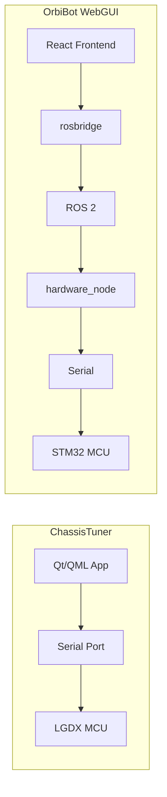

# OrbiBot WebGUI vs LGDXRobot2 ChassisTuner

Comparison and improvement ideas for orbibot_webgui based on studying the [LGDXRobot2 ChassisTuner](https://gitlab.com/lgdxrobotics/lgdxrobot2-chassistuner) reference. Use this document to prioritize and implement improvements later.

---

## Reference: lgdxrobot2-chassistuner

ChassisTuner is a **Qt/QML desktop app** that connects **directly to the robot MCU via serial** (USB VID/PID). It provides:

| Area | ChassisTuner features |
|------|------------------------|
| **Robot Testing** | Connection status, response time, serial number, transform (x,y,θ), forward kinematic, **target/desired/measured motor velocities (rad/s)** per motor, motor CCR, battery 1/2 (V, A), accelerometer/gyro/magnetometer (values + variance), software/hardware/battery-low e-stop breakdown |
| **PID Tuner** | **Motors max speed** (per-motor; auto-config by driving at 99 m/s and measuring), **3-level × 4-motor PID table** (P/I/D per cell), PID speed thresholds, **PID Test**: select motor + level, set P/I/D, send velocity (level or custom), **real-time line chart** (time vs velocity: target line + measured), Stop |
| **Magnetometer Calibration** | Current/custom config, **Start/Stop calibration**, **scatter plot** (XY, YZ, XZ), **hard iron** max/min (x,y,z), **soft iron** 3×3 matrix (ellipsoid-fit), Send / Send Hard Iron Only |
| **Save Configuration** | Single **"Save Configuration"** button writing all settings to MCU flash |
| **Connection** | Serial port list (filtered by VID/PID), Connect/Disconnect, Refresh |

Key difference: ChassisTuner talks **serial → MCU**; OrbiBot WebGUI talks **browser → rosbridge/WebRTC → ROS 2 → hardware_node → serial → MCU**. Any improvement must use existing (or new) ROS 2 topics/services.

---

## OrbiBot WebGUI vs ChassisTuner (gap summary)

| ChassisTuner feature | OrbiBot WebGUI | OrbiBot firmware/driver |
|----------------------|----------------|-------------------------|
| PID **response graph** (time vs velocity) | Not present | No per-motor velocity topic; `/odom` has body vx,vy,ω. Encoder-derived velocity possible on ROS side. |
| **Multi-level / per-motor PID** | Single motor PID + yaw PID only | **Deprecated**: `rosmaster_driver.py` `set_pid_multilevel` is deprecated; single PID only. |
| **Read-back current PID** from MCU | UI only has local state; no “current” from robot | Driver does not publish or expose current PID; firmware may not support read-back. |
| **Magnetometer calibration UI** | No mag calibration in webgui | hardware_node has `CalibrateIMU` service calling `set_mag_calibration(0,0,0)` (trigger). Driver has **hard iron only** (offset_x,y,z); no soft iron. |
| **Save Configuration** (one action) | “Flash” only in PID panel (saves PID) | `pid_save` topic saves PID to flash; no single “save all” in firmware. |
| **Robot Testing / diagnostics** | Scattered: battery, IMU telemetry, encoders, system status, e-stop. No single “hardware testing” view. | `/odom`, `/orbibot/encoders`, `/imu/data`, `/imu/mag`, `/orbibot/system_status`, `/orbibot/emergency_stop` exist. No “response time” or per-motor velocity from MCU. |
| **Motors max speed** (per-motor, auto-config) | Not present | Yahboom protocol: not verified; likely not supported. |
| **Single-motor / IK test** | Teleop only (cmd_vel) | No dedicated single-motor or IK test topic/service. |

---

## Recommended improvements (feasible without firmware changes)

### 1. PID response graph (optional, high value)

- **Idea:** Add a “PID Test” section in `frontend/src/features/telemetry/PIDTuningPanel.tsx`: user sets a target linear/angular velocity, clicks “Send” (publish to `/cmd_vel` for a fixed duration or until “Stop”), and the UI plots **time vs velocity** (from `/odom`: e.g. `twist.twist.linear.x`, `.angular.z`).
- **Data source:** Subscribe to `/odom`; sample at ~20–50 Hz; record timestamps and velocity components. No per-motor velocity needed for a **body** response graph (vx, vy, ω).
- **Scope:** One or two series (e.g. linear.x and angular.z) vs time; optional target line. Use a lightweight chart library (e.g. Recharts, or lightweight canvas).
- **Caveat:** This shows **body** response, not per-motor like ChassisTuner. Still useful for tuning overall motion and yaw.

### 2. Magnetometer calibration entry point

- **Current:** orbibot_hardware exposes `CalibrateIMU` service; driver supports `set_mag_calibration(offset_x, offset_y, offset_z)` (hard iron only).
- **Improvement:** In WebGUI, add a **“Calibrate magnetometer”** (or “IMU calibration”) button (e.g. in a new “Calibration” or “Settings” section, or under PID/telemetry) that calls `/orbibot/calibrate_imu` with appropriate parameters. No need for scatter plot or hard/soft iron matrix unless we later add services/topics to read or set mag offsets.
- **Optional:** Show live `/imu/mag` in a small readout or minimal 2D scatter (e.g. X–Y) for qualitative check; no ellipsoid fit in frontend unless we add backend support for soft iron.

### 3. Hardware / Robot Testing panel

- **Idea:** Add a collapsible **“Hardware testing”** or **“Robot diagnostics”** panel (e.g. in Mission Control or a new tab/section) that aggregates in one place:
  - Connection status (ROS + hardware)
  - **Odometry:** position (x, y, θ) and velocity (vx, vy, ω) from `/odom`
  - **Encoders:** raw counts from `/orbibot/encoders` (and optionally derived wheel speeds if we add a small helper node later)
  - **IMU:** raw accel/gyro/mag from `/imu/data_raw` and `/imu/mag` (if available)
  - **Battery / system:** from `/orbibot/system_status` and enriched status
  - **E-stop / safety:** `/orbibot/emergency_stop`, obstacle state
- **Exclude** (unless firmware/driver gain support): response time, per-motor target/actual velocity, motor CCR, accelerometer/gyro/mag variance.

### 4. Save Configuration clarity

- **Current:** README and PID panel mention “Flash” for saving PID; README documents `pid_save` with 12-value format (legacy multilevel). In practice, PIDTuningPanel and hardware_node use **3 values** (kp, ki, kd) for save.
- **Improvement:** (1) In README, state clearly that “Save to flash” currently persists **motor PID + yaw PID** (or whatever the firmware actually stores) and that there is no single “save all” like ChassisTuner. (2) In the UI, keep a single “Flash” (or “Save to flash”) for PID and add a short tooltip: “Saves current PID gains to robot flash; persists across power cycles.”

### 5. Do not add (or defer)

- **Multi-level / per-motor PID in UI:** Align with current design (single PID); firmware/driver deprecated multilevel.
- **Per-motor max speed / auto-config:** Not in current Yahboom/OrbiBot protocol; skip unless firmware adds it.
- **Soft iron magnetometer calibration:** Driver and firmware only support hard iron offsets; soft iron would require protocol and possibly firmware changes.
- **Serial port selection in WebGUI:** Connection is via ROS 2 (rosbridge); no direct serial in browser.

---

## Architecture note

Improvements stay within the **ROS 2 + rosbridge** pipeline: new UI panels, new subscriptions (e.g. `/odom` for graph), and optional service calls (e.g. `calibrate_imu`). No direct serial or new MCU protocol required for items 1–4.

---

## Suggested implementation order

1. **Magnetometer calibration button** – Small change; exposes existing service.
2. **Save Configuration / Flash wording** – README + tooltip only.
3. **Hardware testing / diagnostics panel** – Improves observability using existing topics.
4. **PID response graph** – Most impactful for tuning; depends on chart library and /odom sampling.

---

## Files to touch (summary)

| Improvement | Files |
|-------------|--------|
| PID response graph | `frontend/src/features/telemetry/PIDTuningPanel.tsx`, possibly new hook for `/odom` sampling, chart dependency |
| Mag calibration button | New component or section (e.g. under Settings/Telemetry); call `/orbibot/calibrate_imu` via roslib Service |
| Hardware testing panel | New component (e.g. `HardwareTestingPanel.tsx` or under MissionControl); use existing hooks (odom, encoders, IMU, system_status) |
| Save/Flash clarity | `README.md`, `frontend/src/features/telemetry/PIDTuningPanel.tsx` tooltip |

No backend (ROS 2) changes required for 1–4 except possibly documenting the existing `calibrate_imu` service in the WebGUI README.

---

## References

- LGDXRobot2 ChassisTuner: [GitLab](https://gitlab.com/lgdxrobotics/lgdxrobot2-chassistuner) | [GitHub](https://github.com/yukaitung/lgdxrobot2-chassistuner)
- OrbiBot WebGUI: [README.md](README.md), [webgui-issue.md](webgui-issue.md), [webgui-changelog.md](webgui-changelog.md)
