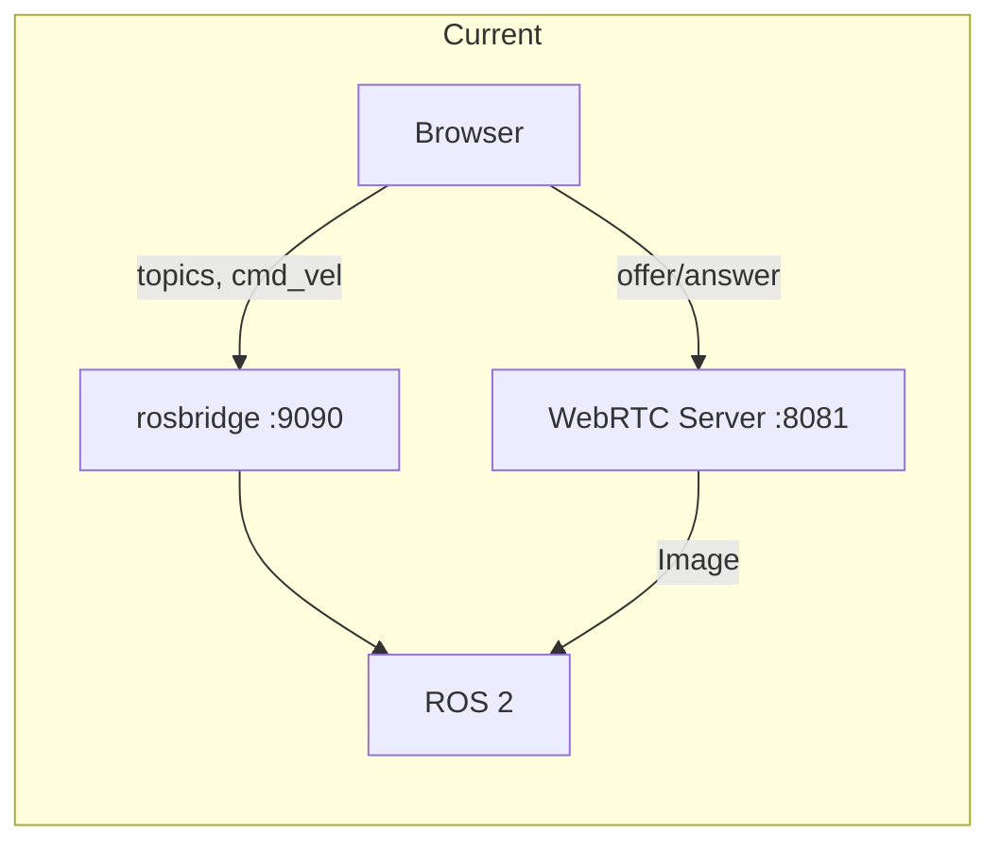

# OrbiBot WebGUI — ros2_web_integration Assessment & Issues

Assessment of `orbibot_webgui` against the [ros2_web_integration](.claude/skills/ros2_web_integration/SKILL.md) skill. **Scope:** local testing and analysis of robot data (not production).

---

## Issues List (summary)

| # | Issue | Scope | Priority (local) |
|---|--------|--------|-------------------|
| 1 | No command timeout watchdog — last velocity can persist if tab/connection drops | Safety | Optional |
| 2 | CORS allows all origins (`*`) in WebRTC server | Production | Defer |
| 3 | No authentication on WebRTC or rosbridge | Production | Defer |
| 4 | rosbridge exposes full topic graph (no filtering) | Production | Defer |
| 5 | rclpy and aiohttp share same event loop (no dedicated spin thread) | Consistency | Defer |
| 6 | MecanumController does not call `stop()` on unmount | Defense in depth | Optional |
| 7 | WebRTC uses raw `sensor_msgs/Image` (CompressedImage could reduce CPU) | Optional | Defer |
| 8 | No rate limiting on WebRTC or rosbridge | Production | Defer |

**For local testing:** Only items 1 and 6 are relevant; both are optional (mitigate by pressing stop before closing the tab). Items 2–5, 7–8 can be deferred until production.

---

## Plan (full assessment)

### Scope

**Intended use:** Local testing and analysis of robot data (not production). No plans for deployment on untrusted networks or multi-user production.

### Summary

**Verdict:** For **local testing and analysis**, the package is **in good shape** and aligns well with the ros2_web_integration skill. Rosbridge + roslibjs is appropriate for quick setup and full topic/service access. The custom WebRTC server gives low-latency video with thread-safe state and proper lifecycle. The only item that remains relevant for local use is **safety**: if the browser tab closes or the connection drops while you are driving, the robot can keep the last velocity (no server-side watchdog). Production-oriented items (CORS restriction, auth, TLS, topic filtering, rate limiting) are **out of scope** for current goals and can be deferred.

---

### What Aligns Well

| Skill recommendation | orbibot_webgui implementation |
|-----------------------|--------------------------------|
| **rosbridge for quick prototyping / local network** | Uses rosbridge_suite + roslibjs; WebSocket URL configurable (e.g. `ws://192.168.x.x:9090`). |
| **WebRTC for low-latency video** | Dedicated WebRTC server ([orbibot_webgui/webrtc_server.py](orbibot_webgui/webrtc_server.py)) with aiortc; ~50–100 ms latency. |
| **Thread-safe shared state** | Lock-protected `FrameBuffer` and `_pcs_lock` in webrtc_server.py. |
| **QoS for sensor data** | WebRTC server uses BEST_EFFORT, VOLATILE, depth 10 for camera. |
| **Connection lifecycle (WebRTC)** | Peer connections tracked, removed on disconnect, closed on shutdown. |
| **Graceful cv_bridge handling** | Optional import with clear error and RuntimeError if missing. |
| **Dependency injection** | `WebRTCApp(node)` — no global node. |
| **Config-driven topics/ports** | [config/webgui_params.yaml](config/webgui_params.yaml), launch params. |
| **Frontend control hygiene** | MecanumController: stopPublishing() on release and e-stop; interval cleared on unmount. |

---

### Gaps vs Skill (detailed)

#### 1. Command timeout watchdog (Skill checklist #6)

- **Skill:** Any endpoint that accepts velocity commands should publish zero if no command is received within 500 ms.
- **Current:** Browser publishes to `/cmd_vel` via rosbridge; no server-side process republishes or enforces a timeout.
- **Implication:** Tab close, network drop, or frontend crash can leave last velocity in effect. `safety_timeout: 1.0` in [config/webgui_params.yaml](config/webgui_params.yaml) is not used by any server logic.

#### 2. CORS allows all origins (Skill checklist #10)

- **Current:** [orbibot_webgui/webrtc_server.py](orbibot_webgui/webrtc_server.py) `_setup_cors()` uses `"*"` for all routes.
- **Implication:** For production, skill expects explicit origins.

#### 3. No authentication (Skill checklist #9)

- **Current:** No auth on WebRTC `/offer` or rosbridge; launch does not use `authenticate:=true`.
- **Implication:** Acceptable for local/dev; required for production.

#### 4. rosbridge exposes full graph (Skill anti-pattern #4)

- **Current:** [launch/webgui.launch.py](launch/webgui.launch.py) starts rosbridge without auth or topic filtering.
- **Implication:** For production, use rosauth and/or topic allowlist.

#### 5. rclpy executor vs web server threading

- **Current:** webrtc_server.py `run_all()` alternates `rclpy.spin_once()` and `await asyncio.sleep(0.01)` in one loop.
- **Skill:** Prefer rclpy in a dedicated background thread, web server in main/asyncio thread.

#### 6. Stop on unmount / disconnect

- **Current:** [frontend/src/features/control/MecanumController.tsx](frontend/src/features/control/MecanumController.tsx) cleanup clears interval but does not call `stop()`.
- **Implication:** Unmount while connected could leave last command in flight; adding `stop()` in cleanup is good practice.

#### 7. Video: raw Image vs CompressedImage (optional)

- **Current:** WebRTC server subscribes to `sensor_msgs/Image`; encoding is server-side (aiortc). Acceptable.
- **Optional:** Use `/camera/color/image_raw/compressed` to reduce in-process memory/CPU if available.

#### 8. Rate limiting (Skill checklist #5)

- **Current:** No rate limiting on WebRTC offer or rosbridge.
- **Implication:** Relevant for production; not required for local testing.

---

### Architecture (current)

Setup is “rosbridge + custom WebRTC,” which the skill considers fine for local/prototyping. For **local testing and analysis**, no production changes are required.

---

### Recommendations (for local use only)

- **Optional (safety during testing):** Add a command timeout watchdog (e.g. ROS 2 node republishing from `/cmd_vel_web` to `/cmd_vel` with 500 ms zero on no input). Otherwise, always press stop before closing the tab.
- **Optional (minor):** In MecanumController, call `stop()` in the `useEffect` cleanup on unmount when still connected.
- **Defer until production:** CORS restriction, auth, rosbridge topic filtering, TLS, rate limiting, dedicated rclpy thread.

---

### References

- Skill: [.claude/skills/ros2_web_integration/SKILL.md](../../.claude/skills/ros2_web_integration/SKILL.md)
- Package: [README.md](README.md), [orbibot_webgui/webrtc_server.py](orbibot_webgui/webrtc_server.py), [launch/webgui.launch.py](launch/webgui.launch.py), [config/webgui_params.yaml](config/webgui_params.yaml).
